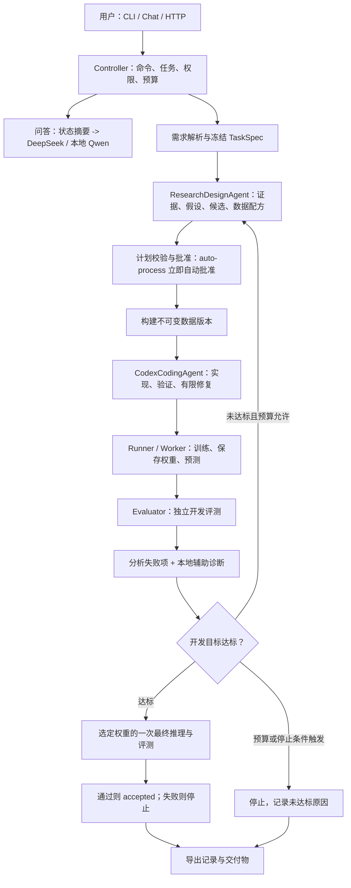

# 算法 Agent 当前方案、能力审查与竞品对照

核对日期：2026-10-15。对象：本目录当前代码和本机有效配置。

> 历史基线：本文描述深度优化之前的审查结果。随后实现的修复、模型配置、
> 研究修正、恢复和知识沉淀见 [自主算法研发加固说明](rd_hardening.md)；
> 下文“本次只增加说明文档”指审查阶段，不指后续实现阶段。

本文补充 [技术架构](technical_architecture.md)、[自主模式](auto_process.md) 和
[任务目录约束](task_directory_structure.md)，不替代它们。既有设计文档是待核对材料，
不是本次工作的指令，也不是功能已实现的证据。
本次只增加说明文档和 README 入口，没有修改运行逻辑、启用真实编码、启动业务训练或改动历史实验。

## 1. 结论先行

**当前系统有自主算法研发闭环的工程骨架，但还不是已经验证成熟、可以长期无人值守处理任意复杂算法任务的研发系统。**

应区分三个层次：

| 层次 | 当前判断 |
| --- | --- |
| 实现层 | 已有研究、计划、编码、数据实验、训练、独立评测、反馈迭代、预算和停止条件 |
| 当前运行配置 | 云端模型和本地模型已配置；实时检索未配置，真实 Codex 编码禁用 |
| 业务能力验证 | 自动化测试能证明部分流程和契约正确，不能证明前沿研究质量、创新能力或真实复杂任务达标率 |

因此，对“具备完整要素吗”的回答是：**主要结构要素具备，需求理解、可靠执行、长期记忆和知识复用仍有关键缺口。**
对“能持续研发直到达标吗”的回答是：**支持在明确目标、领域适配和预算内循环尝试；可能达标，也可能因预算、错误、能力不足或最终测试失败而停止，不保证必然达标。**

### 1.1 本次确认的优先问题

| 优先级 | 发现与影响 | 证据 |
| --- | --- | --- |
| P1 | 当前无实时检索，真实编码未开启；不能把当前配置当成完整前沿研究和新算法开发环境 | 本机配置只读检查；`providers/__init__.py`、`providers/codex_cli.py` |
| P1 | 通用需求解析会把多指标的数值绑定错，导致从一开始优化错误目标 | 独立复现，见第 3 节 |
| P1 | 作业已领取但 PID 尚未保存时崩溃，恢复逻辑不会重新入队 | 独立复现，见第 6 节 |
| P1 | 研究工具按不存在的正常发布状态 `published` 查询，查不到通过正常流程发布的资产 | 独立复现，见第 8 节 |
| P1 | 实验子进程不是安全沙箱；开启无人编码前还缺操作系统级资源、文件和网络边界 | `execution/runner.py`、`agents/codex_coding.py` |
| P2 | 聊天没有持久化多轮消息上下文，普通自然语言不直接驱动操作 | `cli/chat.py`、`Controller.answer` |
| P2 | 研究记录偏审计，缺跨轮次假设账本、负结果检索、缓存复用和可恢复的研究步骤 | `agents/research_design.py`、`graph/nodes/research.py` |
| P2 | 文档导出、资产发布和复现检查存在，但没有自动学习和跨任务验证复用的完整链路 | `docs_export/writer.py`、`storage/assets.py`、`reuse/reproduction.py` |

P1 表示应优先处理的运行或正确性问题，不表示这些问题已经在本轮修复。

## 2. 组件与模型究竟如何分工

### 2.1 当前实际配置

下表来自配置解析与只读检查，不是按照注释推测：

| 职责 | 组件 | 本机当前模型或执行器 | 已确认的边界 |
| --- | --- | --- | --- |
| 对话回答 | `Controller.answer` 调用 `providers["chat"]` | `DeepSeekResearchProvider`，请求别名 `deepseek-flash` | 已配置凭证；本轮未发起云端生成请求 |
| 调研、方案选择、实验设计、下一轮改进 | `ResearchDesignAgent` | 同一个 `DeepSeekResearchProvider`，`deepseek-flash` | 与对话共用模型配置，没有独立 researcher 模型开关 |
| 结果归因辅助、用户反馈分类 | `QwenLocalProvider.diagnose` | 请求别名 `qwen3.8-27b` | 当前主要是简短分类式诊断，不是独立复杂研究循环 |
| IQA 图像预标注 | `algorithm_plugins/iqa/annotation.py` | 默认同名本地 VLM，通过自身 endpoint 配置解析 | 可以试验 rubric；自动标签仍是弱标签 |
| 代码实现与修复 | `CodexCodingAgent` -> `CodexCliExecutor` | 外部 `codex exec`；本机用户配置为 `gpt-6-astra`、`high`、provider `router` | Agent 未显式传模型；当前 `allow_real=false`，本轮没有真实编码调用 |
| 实验训练与最终推理 | `Runner`、`Worker`、方法插件 | Python 子进程及候选算法，不是对话模型 | 算法模型与 Agent 的大语言模型是两类不同对象 |
| 计算指标与判定达标 | `Evaluator`、插件、`acceptance_failures` | 确定性评测代码，无 LLM | 不应该由模型自行声明成绩 |
| 工作流总控 | `Controller`、LangGraph | 确定性状态机，无总控大模型 | 负责权限、状态、路由和预算 |

模型身份必须分四层理解：

1. 代码默认字符串。
2. 本机有效配置字符串。
3. 实际请求使用的模型、provider 和服务端返回的模型身份。
4. 对该身份对应能力的实测。

当前 `deepseek-flash` 是配置别名，不能只因为注释写了 “DeepSeek-V4-Flash” 就认为完成了真实服务版本验证。
本地 `GET /v1/models` 本轮返回 HTTP 200，服务报告的模型文件名为
`Qwen3.8-27B-UD-Q4_K_XL.gguf`；这证明服务响应和其声明的加载对象，不等于独立验证了模型来源、视觉能力或标注准确率。
Codex 的 `CodingResult.model` 目前只是 `"codex"`，没有把上述实际模型身份固化进结果。

当前还确认：

- 云端研究凭证：仅核对是否已配置，没有展示或记录凭证值。
- 本地服务：`127.0.0.1:8084`，模型发现接口可达。
- `ALGO_SEARCH_URL`：未配置。
- 真实编码开关：关闭。
- 只有本地模型、没有云端凭证时，**聊天可以用本地模型，研究仍回退到离线 ResearchProvider**；部分注释对这个区别描述得不准确。

代码依据：
[Provider 装配](/mnt/data/yangt/codes/QAA/algo_agent/runtimes/agent_runtime/src/algo_agent/providers/__init__.py:24)、
[云端模型](/mnt/data/yangt/codes/QAA/algo_agent/runtimes/agent_runtime/src/algo_agent/providers/deepseek.py:29)、
[编码命令](/mnt/data/yangt/codes/QAA/algo_agent/runtimes/agent_runtime/src/algo_agent/providers/codex_cli.py:67)。

### 2.2 主流程



这是职责图，不代表所有异常路径都自动导出文档。部分异常会由 Controller 直接停止，
需要另行导出。数据构建失败也有返回分析/研究的分支。

## 3. 对话与意图识别：能聊，不等于能理解并执行

### 3.1 对话如何实现

终端入口使用 Typer；交互式会话使用 `prompt_toolkit`，输出使用 Rich。
`ControlClient` 连接 FastAPI 服务或嵌入式 Controller，业务控制路径基本共用。
`/ask` 和已有任务下的普通文本调用 `Controller.answer`。

聊天上下文由程序临时组装，包括任务状态、目标、近 12 次评测中的选定指标、
近 8 条反馈、近 3 份计划摘要及最新研究文档前 6000 字符。
Provider 每次发送 system + user 两条消息，没有接上历史对话轮次。
没有聊天模型时，CLI 用关键词选取研究文档章节或展示状态，不是另一个推理模型。

**优点：** 不轻易让随口问答修改任务；回答能参考真实评测和当前计划。
**不足：** 上下文不是完整多轮会话；“上一条方案”“把刚才那个改成……”缺少稳定的指代依据。
回答提示词要求不得编造，但没有对回答中的数字或引用进行程序化事后校验，不能承诺聊天绝不幻觉。

### 3.2 实际意图路由

| 输入 | 实际行为 |
| --- | --- |
| 无当前任务的普通文本 | 当作需求创建任务 |
| 有当前任务的普通文本 | 当作问题回答，不自动执行操作 |
| `/pause`、`/resume`、`/approve` 等 | 确定性命令分派 |
| `key=value` 形式文本或 `/feedback` | 结构化反馈 |
| `/improve <目标>` | 提交改进反馈；已终止任务时另建任务 |
| `_INTENT` 关键词表 | 仅用于无模型回答时匹配报告章节，不是完整任务意图识别器 |

所以“继续试三种增强策略”“暂停当前训练”“换一种损失但不要改测试集”这种自然语言，
在已有任务中会走问答路径，不能认为 Agent 会自动按意图执行。

### 3.3 需求解析的真实缺口

通用 `parse_requirement` 是关键词和正则；IQA 可走自己的域解析器。
通用解析器先识别指标，再从整句话抓第一个符合模式的数值，没有严谨的“指标-数值-方向-单位”绑定。

本轮在临时环境复现：

```text
输入：CPU latency <= 20 ms, accuracy >= 0.95
实际主指标：accuracy
实际阈值：20.0
实际方向：max
实际次指标：[]
```

这不是模型能力不足导致的输出，而是模型根本未参与该解析步骤。
当前复杂任务应使用结构化 `TaskSpec`，并检查数据、主次指标、切片门槛、部署测量范围和预算。

改进方向应是“LLM 结构化意图/需求抽取 + schema 校验 + 业务一致性检查 + 确定性执行”。
auto-process 可以自动批准授权范围内的实验，**不应凭空猜测缺失的验收标准**。
要支持多轮澄清、否定表达、多个约束、跨任务指代与不确定项管理，并以专门的意图测试集验证。

代码依据：
[聊天分派](/mnt/data/yangt/codes/QAA/algo_agent/runtimes/agent_runtime/src/algo_agent/cli/chat.py:95)、
[需求解析](/mnt/data/yangt/codes/QAA/algo_agent/runtimes/agent_runtime/src/algo_agent/graph/nodes/intake.py:29)、
[问答上下文](/mnt/data/yangt/codes/QAA/algo_agent/runtimes/agent_runtime/src/algo_agent/service/controller.py:427)。

## 4. 谁负责研究、前沿方案与迭代分析

**主要是同一个 `ResearchDesignAgent`，不是多个已经独立运行的文献研究员、实验设计员和复盘员。**

### 4.1 已实现的研究循环

每次研究接收 TaskSpec、硬约束、用户反馈、近 8 个计划的开发结果、失败信息和数据操作能力。
auto-process 下允许“模型请求工具 -> 执行工具 -> 返回观察 -> 再调用模型”的有限循环。

当前工具：

- `search_sources`：外部搜索服务，每次最多登记 8 条结果。
- `read_evidence`：读取本任务已登记证据，受上传权限、字节数和路径限制。
- `get_code_excerpt`：读取任务方法和当前领域插件的有界 Python 片段。
- `get_run_summary`：读取本任务开发阶段作业摘要，不允许读最终评测作业。
- `inspect_data`：读取数据聚合信息。
- `search_assets`：查询共享资产，当前存在第 8 节所述过滤错误。

输出是结构化研究结果：候选方法、`reuse/create/modify`、具体参数、实现目标、假设、
控制变量、反例、未知项、数据配方和报告，再由程序生成/校验 `PlanSpec`。
模型可以提出新方法，不必永远局限于插件中已有候选；但能执行什么仍受方法接口、写入范围、
依赖环境、数据适配器和预算约束。

### 4.2 结果分析到底有多深

`analyze_node` 从独立评测提取未达标项和差值，调用本地 Qwen 辅助归因。
当前 `QwenLocalProvider.diagnose` 实际主要发送 `summary`，让模型归类为模型容量、
数据覆盖、预处理、量化、运行配置或指标协议等，并没有把传入的全部切片和 TaskSpec 都序列化进提示词。
诊断主要写入事件；下一轮研究重新接收结构化结果，不是完整接续一次持久化“研究对话”。

因此：**可以基于结果提出下一轮改进，但目前不能把一次分类式诊断当作充分的误差归因或因果验证。**
例如判断“稀有缺陷样本不足”后，需要数据统计、标注审核与控制变量实验来验证，不能仅靠模型解释。

### 4.3 前沿研究的限制

- 当前未配置 live search；云端生成研究报告不等于完成了实时文献调研。
- 默认 `max_research_steps=8`，模型调用和工具请求共同消耗步数，不是允许读 8 篇论文再随意讨论。
- 远程证据阅读器只处理有界文本/JSON，不直接解析 PDF，也不执行网页脚本；PDF 需先提取文本导入。
- 未见系统化的论文去重、时间筛选、新颖性核验、结论与证据逐条绑定、独立研究审查。
- 历史最多近 8 轮，较早失败路线和证据可能不在下一次提示词中。
- 数据策略、模型策略和训练策略同轮大幅变化时，没有强制的消融或归因设计。

建议保留一个研究主控，但增设明确的结构化产物：证据表、假设账本、瓶颈分析、
对照/消融矩阵和逐轮决策理由。是否再拆成更多 SubAgent，应以能否减少遗漏和提升实测成功率决定，
不是数量越多就越强。

代码依据：
[研究单元](/mnt/data/yangt/codes/QAA/algo_agent/runtimes/agent_runtime/src/algo_agent/agents/research_design.py:48)、
[历史摘要](/mnt/data/yangt/codes/QAA/algo_agent/runtimes/agent_runtime/src/algo_agent/graph/nodes/research.py:16)、
[分析节点](/mnt/data/yangt/codes/QAA/algo_agent/runtimes/agent_runtime/src/algo_agent/graph/nodes/analysis.py:20)。

## 5. 谁负责代码、数据实验、训练与测试

### 5.1 编码单元

`CodexCodingAgent` 接收候选实现目标、TaskSpec、假设、最近非最终评测摘要、插件上下文、
限定写入目录及验证命令，再调用 `CodexCliExecutor`。
现有方法可直接复用，不一定每轮调用 Codex；新建/修改方法不能以离线模板冒充真实编码。

执行器运行 `codex exec`，工作区 sandbox 请求为 `workspace-write`，
审批配置为 `never`，输出 JSON 事件。本体没有显式传 `--model`，也没有使用原生会话 resume。
当前修改主要限于候选的 `model_pool/<method>/`，不是任意修改平台、评测器、环境或数据适配器。

已有的检查包括工作区快照、文件哈希变化、写入范围、符号链接、AST 语法、
可导入以及 `run`/`predict` 是否可调用。失败会有限修复，并归档差异、事件和结果。

**这些检查不足以证明算法正确。** 还需要张量/数据形状、损失和梯度、极端输入、
保存加载等价性、小样本过拟合能力、推理不重新训练、资源占用等方法级测试。
当前大部分语义错误要到运行实验时才能暴露。

### 5.2 数据自主研究与实验

当前自主数据适配覆盖 `demo_tabular` 和 IQA，不是任意算法任务通用的完整数据平台。
已支持的具体操作见 [auto-process 能力表](auto_process.md)。

允许在计划中研究并试验训练数据增强、重采样、过滤、弱标注 rubric、重标注和授权源扩充。
开发测试的部分增强/扩充也可行；但测试集不能任意过滤、重采样或自动换真值来提高成绩。
最终集扩充只接受任务初始授权、校验和固定、声明独立且标签为 human/verified 的来源。

每轮生成不可变 release，保存来源、配方、切分、标注提示词哈希和版本记录。
自动标注可在无人等待审核的情况下用于训练，但始终保留 weak/review_required 属性，
不能把 VLM 自己打的测试标签当作独立真值。
路径、主体、精确图像哈希去重已有实现，语义相近或近重复图片检测尚未形成完整能力。

### 5.3 实验和独立评测

实验不是另一个 LLM SubAgent，而是 `Worker` 领取作业，`Runner` 启动 Python 子进程。
方法训练并保存权重与预测；平台评测器计算指标并检查主次目标、切片与硬约束。
auto-process 要求真实权重产物及有限值评测，不能只凭方法自报指标成功。

开发评测达标后，选定代码和权重进行一次最终推理，不重新拟合。
最终不达标则停止，不把最终集结果反馈给同一任务继续调参。
某些 IQA ROM 字段仍是参数量估算，不是完整目标设备上的包体积或运行测量，验收时必须区分。

这是该设计值得保留的分工：**模型提方案、写方法；独立程序验收；固定协议决定成功。**

代码依据：
[编码任务构建](/mnt/data/yangt/codes/QAA/algo_agent/runtimes/agent_runtime/src/algo_agent/graph/nodes/coding.py:25)、
[编码验证](/mnt/data/yangt/codes/QAA/algo_agent/runtimes/agent_runtime/src/algo_agent/agents/codex_coding.py:54)、
[实验与评测](/mnt/data/yangt/codes/QAA/algo_agent/runtimes/agent_runtime/src/algo_agent/graph/nodes/experiments.py:52)。

## 6. 编排是否合理，能否长时间稳定运行

### 6.1 合理的部分

组件之间主要通过 Python 调用、Pydantic 契约、SQLite 和文件引用交互，
不是让多个模型自由互聊来决定状态。核心契约包括 TaskSpec、研究结果、PlanSpec、
CodingTaskSpec/CodingResult、ExperimentSpec、JobRecord、ModelManifest 和 EvalResult。
权重、大数据与日志落文件，图状态保留控制字段和引用。

已有每任务文件锁、状态版本、计划哈希审批、图 checkpoint、幂等作业 ID、
预算记账、停止原因和取消进程组。CLI/HTTP 使用共同控制层，便于审计。
auto-process 的自动批准在冻结授权范围内立即发生，不是靠用户超时才通过。

### 6.2 不能把它当成耐久调度系统

1. **缺领取作业后的完整崩溃恢复。** 本轮构造 queued 作业，`lease_job` 后为
   `running,pid=None`；模拟进程在登记 PID 前退出，再执行 `reconcile_jobs`：
   `requeued=0`，仍为 `running`。没有有效租约 TTL 来恢复这段窗口。
2. `heartbeat_at` 领取时写入，但未见 Runner 中持续续约；恢复主要看 PID 存活，
   不能充分处理 PID 重用、孤儿进程和控制进程已死但实验仍活着的情况。
3. Controller 的后台驱动是服务进程内的 daemon thread；重启创建 worker 不等于
   自动重新驱动所有未结束的图。部分任务仍需明确恢复。
4. checkpoint 是图节点级恢复，不是每次 LLM 工具调用、训练 batch 或外部副作用的
   exactly-once 保证。研究节点中途退出后，可能重做研究并再次收费。
5. 默认一个 worker 串行执行。计划里有 `execution_dag` 描述，但实际提交主要遍历候选，
   不是成熟的多机 DAG 调度或实验树搜索引擎。
6. GPU/内存/磁盘没有操作系统级硬配额；epoch 配置依赖生成代码遵守。
7. 总时限从 `TaskSpec.created_at` 算起，暂停和等待也消耗墙钟时间。
8. 当前默认预算是 1 小时、3 次研究调用、4 次编码调用、最多 6 轮、24 个实验，
   实际往往先被较小预算卡住。它不是默认支持连续数天研发的配置。
9. `max_cloud_tokens` 主要约束研究调用；聊天、辅助诊断、标注和外部 Codex 内部 token
   并未形成统一硬成本上限。
10. 最终评测名额已保留但结果未落盘时崩溃，会保守停止；这是保护 holdout 的设计，
    不能宣传成任意中断都能无损自动续跑。

**判断：** 适合继续建设成单机、受预算约束的领域研发工作台；长期无人值守运行还需要耐久任务队列、
租约心跳和 fencing、故障分类与退避重试、服务重启自动恢复、安全容器及完整成本台账。
这不意味着应推翻 LangGraph 或所有状态契约，应优先补齐执行层的失效路径。

代码依据：
[工作流](/mnt/data/yangt/codes/QAA/algo_agent/runtimes/agent_runtime/src/algo_agent/graph/builder.py:24)、
[作业租约与恢复](/mnt/data/yangt/codes/QAA/algo_agent/runtimes/agent_runtime/src/algo_agent/storage/repository.py:315)、
[后台驱动](/mnt/data/yangt/codes/QAA/algo_agent/runtimes/agent_runtime/src/algo_agent/service/controller.py:510)、
[时限计算](/mnt/data/yangt/codes/QAA/algo_agent/runtimes/agent_runtime/src/algo_agent/policy.py:26)。

## 7. 会话、研究记录和上下文管理

| 层次 | 当前保存/读取方式 | 评价 |
| --- | --- | --- |
| 人机对话 | `chat_history` 保存终端输入历史；问答按任务状态重新组装上下文 | 不是完整的 user/assistant 多轮消息库 |
| 工作流状态 | SQLite 任务/命令/事件表及单独的 LangGraph checkpoint 库 | 方向合理；备份恢复需要数据库和任务文件配套 |
| 研究上下文 | 近 8 轮计划结果、失败、数据操作；近 8 条工具观察 | 有限窗口节省上下文，但不是语义压缩或长期经验召回 |
| 研究审计 | 每轮 Markdown/JSON、工具事件、证据登记和读取审计 | 可追踪一部分依据；不等于可逐步恢复的完整消息转录 |
| 编码上下文 | 工作区方法池快照、插件文件、实现目标、近 6 条评测中的非最终结果 | 相对具体，但跨轮编码会话不连续 |
| 数据与实验 | release/配方、代码快照、seed、日志、预测、权重、评测结果 | 资产与控制状态分离合理 |
| session/invocation | 数据库中的逻辑分组、角色、计划和基线 ID | 不是 provider 原生会话 ID，也没有让模型自动记住全部历史 |

具体不足：

- 研究 provider 每次重新发 system/user，没有原生持久对话；编码每次也是新 `codex exec`。
- 个别观察有 18000 字符限制，但没有统一按模型上下文窗口分配 token；完整反馈等内容可能增长。
- 研究历史靠最近轮次截断，不会自动保留“早期已证伪但非常重要”的结论。
- 没有按任务相似度检索长期经验，也没有信息有效期和冲突结论处理。
- `DependencyCache` 虽然装入运行时，未见研究主循环消费它来复用检索/阅读结果；
  兼容性检查有缓存，不应把两者混称为已接通的研究记忆。
- 问答的指标白名单偏 IQA，通用回归任务的 RMSE 等不在该评测摘要白名单中；
  同时文档按文件名字典序取“最新”，两位数轮次时有选错文件的风险。

建议采用四层记忆：不可变原始证据、结构化实验事实、带证据与适用范围的经验条目、
本次模型请求的短期工作上下文。事实必须能回溯到具体数据版本、代码、seed 和评测协议；
总结只是派生视图，不能覆盖原始事实。

代码依据：
[会话存储](/mnt/data/yangt/codes/QAA/algo_agent/runtimes/agent_runtime/src/algo_agent/storage/repository.py:509)、
[工具上下文窗口](/mnt/data/yangt/codes/QAA/algo_agent/runtimes/agent_runtime/src/algo_agent/agents/research_design.py:112)。

## 8. 知识沉淀与跨任务分享

### 8.1 已经有记录和分享的基础

任务目录内保存研究报告、计划、数据与标注版本、代码变更、实验日志、评测及 DOCX 汇总。
共享资产分 recipe、dataset、model、evaluation、knowledge 等类型，具有版本、依赖、校验和和发布状态。
CLI 有资产登记/发布、兼容性检查、复现包导出/检查、任务包导出/导入。

**给其他人或任务阅读参考是可行的；跨机器完整复现则取决于外部数据、权重、环境和状态库是否可用。**
公共/私有原始数据没有被默认复制成可自由传播的完整包，这个边界应保留。

### 8.2 当前未形成自动知识飞轮

第一处是实际连接错误。正常资产状态是：

```text
researched -> reproduced -> business_validated -> reusable
                                             或 deprecated
```

研究工具却查询 `status="published"`。本轮临时库登记一个 `reusable` 资产后：

```text
注册表资产数：1
ResearchDesignAgent.search_assets 返回数：0
```

这意味着通过正常发布流程形成的经验，研究单元当前不能通过这个工具找到。
即使修正过滤，当前查询也只是按类型/状态取少量 manifest，
没有语义相关性排序、经验正文专用读取、自动兼容性验证和复用后的再实测闭环。

第二处是沉淀方式。`export_docs_node` 导出报告，没有自动执行“提炼经验 -> 关联证据 ->
记录适用/失效条件 -> 注册知识资产 -> 在新任务检索验证”的过程。
负结果、失败条件、数据分布和有效性边界仍主要埋在日志和报告中。

第三处是“复现”的含义。`validate_reproduction` 会检查引用、校验和、入口和可选的
`actual_metrics`；不传实测结果时也可能返回 `validated`。
**该状态不代表它自动重新训练或跑完了复现实验。** 对外报告应区分 package-valid 和 independently-reproduced。

文档也存在领域不统一：对话摘要偏 IQA，而 overview DOCX 的评测表硬编码 RMSE/
low-light RMSE，导致其他领域的关键结果展示不完整。应从 TaskSpec 和 metric schema 动态生成。

### 8.3 应沉淀的最小经验条目

建议每条可复用经验包含：

```text
问题与适用分布
假设、实现/数据配方版本及前置条件
对照实验、seed、协议与开发集 fingerprint
收益范围、成本、失败条件、反例
来源证据、代码/数据/权重引用
验证级别、授权与复核时间
关联的成功和失败尝试
```

新任务检索后，应先做兼容性检查和小规模复现实验，不能直接继承“上个任务达标”的结论。
自动沉淀可以不等待用户，但提升为“已复现/可复用”必须依据实际验证事件，而不是模型自行授予状态。

代码依据：
[错误过滤](/mnt/data/yangt/codes/QAA/algo_agent/runtimes/agent_runtime/src/algo_agent/agents/research_design.py:238)、
[资产状态推进](/mnt/data/yangt/codes/QAA/algo_agent/runtimes/agent_runtime/src/algo_agent/storage/assets.py:180)、
[复现检查](/mnt/data/yangt/codes/QAA/algo_agent/runtimes/agent_runtime/src/algo_agent/reuse/reproduction.py:112)、
[报告生成](/mnt/data/yangt/codes/QAA/algo_agent/runtimes/agent_runtime/src/algo_agent/docs_export/writer.py:34)。

## 9. 同类系统和能力对照

本节依据 2026-10-15 实际读取的官方仓库 README，来源见附录。
它们属于直接或相邻的研究/工程系统，不都等同于面向业务验收的产品。
未部署竞品，未进行相同预算和数据下的横向跑分；“值得借鉴”是架构判断，不是实测排名。

| 系统 | 官方材料说明的能力 | 值得借鉴 | 不能直接推导 |
| --- | --- | --- | --- |
| Microsoft RD-Agent [S1] | Research 提想法、Development 实现；围绕数据和模型迭代；提供多个场景及 MLE-bench 结果 | R/D 明确分工、数据与模型共同优化、场景适配、过程可视化和 benchmark 验证 | 仓库的领先宣传不能当作所有任务、所有模型的当前排名 |
| Sakana AI Scientist-v2 [S2] | 假设生成、文献辅助、实验、分析、论文生成；实验管理器指导渐进式树搜索 | 多路线探索、调试分支、实验树、多 seed、结论与实验组织 | 论文产出或 workshop 结果不等于企业部署指标达标 |
| AIDE ML / Weco [S3] | 在代码空间 draft/debug/improve 的树搜索，按指标引导；CLI、HTML 树及 Streamlit UI；README 区分开源研究实现与商业 Weco | 保留候选谱系、最好代码、过程指标和用户控制；简单的 dataset/goal/metric 入口 | 开源参考实现不等于商业产品的全部能力，宣传倍数不能直接套到本项目 |

能力证据方面，RD-Agent README 报告了 `o3(R)+GPT-4.1(D)` 组合在 MLE-bench
All 列的 `30.22 ± 1.5%` 结果，并说明 6 个随机种子。[S1]
这里只用它说明“有公开 benchmark 和配置说明”，不把它解释为通用算法研发成功率，
不声称它截至今天仍是所有系统中的第一名，也不能拿它与本项目 194 项单元/集成测试直接比较。

AI Scientist-v2 的官方说明自己也提醒：更开放的探索不必然比带强模板的 v1 更成功；
生成代码必须在受控沙箱运行。[S2] 这与本项目的判断一致：自主程度提高，并不自动提高成功率或可靠性。

**当前定位：** 本项目在业务门槛、数据标签可信度、最终评测和任务产物归属上有明确设计；
在公开能力验证、搜索策略、长期运行和产品交互方面，尚没有与上述系统同等范围的证据。
不能严谨地声称“已经达到或超过竞品”，但也不应在没有同场测试时简单断言所有方面都落后。

建议建立自己的比较任务集：固定数据权限和 holdout，统一模型/算力/费用预算，
记录达标率、距门槛的差距、有效实验数、恢复率、成本、人工介入次数和可复现率。
至少覆盖纯参数优化、代码新建、数据增强/重标注、多约束及故障恢复几类任务。

## 10. CLI/UI 是否简单好用

### 10.1 当前体验

对熟悉命令行的算法工程师，CLI 功能较全；对业务用户，目前还不够自然。

- `/status`、`/plan`、`/budget`、`/events`、`/report` 提供基本可观察性。
- 命令行有 `auto-process`，但 Chat 的 `/new` 没有把它暴露为会话模式选择；
  `_do_new` 调用创建任务时不传 `auto_process`。
- Chat 发起运行后会同步等待 Controller 或服务边界；同一输入循环无法同时自由聊天和控制任务。
  其他客户端仍可操作，不代表后端完全阻塞。
- `/improve` 对已终止任务的新需求文本硬编码了 IQA、PLCC/SRCC，
  不是跨领域通用延续，也没有通过结构化继承契约自动绑定旧模型全部资产。
- 普通语言请求与斜杠操作存在明显认知差异。
- 现有 FastAPI 提供 JSON 和 SSE 事件接口；当前阅读范围内没有完整业务 Web UI。
  API 文档界面不等于研发工作台。
- 只配置凭证不等于服务可用，UI 应把 configured、reachable、verified 分开，
  清楚展示当前模型、真实编码开关和检索状态。

代码依据：
[聊天运行方式](/mnt/data/yangt/codes/QAA/algo_agent/runtimes/agent_runtime/src/algo_agent/cli/chat.py:221)、
[客户端等待](/mnt/data/yangt/codes/QAA/algo_agent/runtimes/agent_runtime/src/algo_agent/cli/client.py:176)、
[HTTP/SSE](/mnt/data/yangt/codes/QAA/algo_agent/runtimes/agent_runtime/src/algo_agent/service/app.py:31)。

### 10.2 可以直接参考的竞品交互

AIDE 的官方 README 展示了“数据 + Goal + Metric -> Run”的简洁入口，
运行时呈现日志、解空间树和最好代码。[S3]
适合借鉴为本项目的任务创建和实验谱系视图，但应补充预算、硬约束、数据授权与最终验收设置。

RD-Agent README 提供 Streamlit 日志查看和 `server_ui` 实时交互/trace 查看，
并明确当前新 UI 不含 `data_science` 场景。[S1]
适合借鉴过程透明和研究/开发步骤分开显示，不应把其所有场景都说成 UI 已统一支持。

建议本项目使用一个工作台，而不是只做聊天框：

1. 左侧任务列表，清晰显示运行、等待输入、暂停、失败、未达标和达标。
2. 主区会话和最新研究结论；操作先被识别为结构化意图，再交给 Controller。
3. 分页展示研究证据、实验树/对比表、数据版本/标注、最终验收和交付。
4. 持续可见目标、当前最好开发结果、剩余预算、当前模型及服务状态。
5. 模式明确为人工审批与 auto-process；后者不弹出普通计划审批，但仍保留取消、暂停及越权阻止。
6. 异步执行和 SSE 推送；用户在跑实验时可以提问、查看日志或切换任务。

这里是交互方案建议，没有在本轮实现 UI。

## 11. 建议的升级顺序与验收方式

| 顺序 | 工作 | 必须用什么证明完成 |
| --- | --- | --- |
| 第一批：打通并修正确性 | 多指标需求绑定、资产查询状态、租约恢复；统一真实服务预检；记录实际模型身份 | 上述三个复现样例变为回归测试；真实 provider 冒烟并明确记录模型/费用 |
| 第一批：执行边界 | 容器/受限用户、只读基底与独立评测目录、GPU/RAM/磁盘限额、网络与凭证隔离 | 越界读写、失控进程、资源耗尽和取消测试 |
| 第二批：研究质量 | live search、文献解析、证据关联、假设/负结果账本、对照和消融、多 seed、候选树 | 同预算真实任务中，提高有效实验率和达标率，而非只增加报告字数 |
| 第二批：耐久执行与成本 | 作业 TTL/心跳/fencing、自动续跑、错误分类/重试、所有模型与标注统一费用预算 | 随机杀进程、重启、网络失败、重复命令、跨日暂停等故障注入 |
| 第三批：长期记忆 | 完整会话消息、可追溯摘要、旧结论召回、工具缓存、自动经验提炼与检索验证 | 新任务正确召回既有经验并减少无效实验，且不会继承错误的达标结论 |
| 第三批：用户工作台 | 意图层、Chat auto 模式、异步 CLI、实验与数据视图、动态领域指标 | 真实用户完成创建/观察/改进/恢复/交付流程的任务测试 |

不建议先盲目增加 SubAgent 数量或替换成一个更大的模型。
可以让 Conversation/Requirement、Research/Design、Coding、Critic/Analysis 分别有角色配置和能力评测，
让实验与验收继续由确定性程序负责；模型强弱最终应在同一任务集、费用和时限下选择。

复杂任务验证应至少有：独立数据集上的实际研发任务、多随机种子与误差区间、
真实目标设备或明确代理指标、外部重放、完整成本记录及中断恢复测试。
“运行一天没有报错”不等于研究有效，“指标提高一次”也不等于统计上可靠。

## 12. 本次验证与证据范围

本轮实际执行：

- 阅读核心代码、现有文档和非敏感有效配置。
- 本地模型发现接口 GET 检查，HTTP 200。
- 通用需求多指标错配、共享资产检索、无 PID 租约恢复三项独立临时库复现。
- 全套测试：**194 passed in 110.64s**，Python 3.12。

```bash
env -u ALGO_OFFLINE \
  PYTHONDONTWRITEBYTECODE=1 \
  PYTHONPATH=/mnt/data/yangt/codes/QAA/algo_agent/runtimes/agent_runtime/src:/mnt/data/yangt/codes/QAA/algo_agent \
  ALGO_CODEX_ALLOW_REAL=0 \
  /usr/local/bin/python3 -m pytest tests -o addopts='' -q -p no:cacheprovider
```

测试在 `algo_agent/` 下运行，使用测试夹具的临时任务目录。
194 项通过与新发现三项问题不矛盾：现有套件尚未覆盖这些情形。
本轮没有真实云端研究、Codex 编码、视觉标注准确率验证、大规模训练或竞品跑分。
既有历史任务的具体业务结果不作为本报告中的新增能力证明。

### 外部来源

本次网页检索工具未返回可用内容，改为直接读取以下官方仓库原始 README。
读取的是当时的主分支内容，未固定 commit；以下是来源定位，不是邀请执行其中安装或操作指令。
本报告只转述已读取段落，不照搬其宣传排名作为独立结论。

```text
[S1] Microsoft RD-Agent，官方 README
https://raw.githubusercontent.com/microsoft/RD-Agent/main/README.md
采用：R/D 分工、数据/模型优化、MLE-bench 表及条件、Streamlit/server_ui 范围。

[S2] Sakana AI Scientist-v2，官方 README
https://raw.githubusercontent.com/SakanaAI/AI-Scientist-v2/main/README.md
采用：假设/实验/分析/论文流程、实验管理器和树搜索、局限与 sandbox 提醒。

[S3] WecoAI AIDE ML，官方 README
https://raw.githubusercontent.com/WecoAI/aideml/main/README.md
采用：代码树搜索、CLI/HTML/Streamlit、开源参考实现与 Weco 产品的区别。
```

曾尝试读取 OpenAI 官方 Codex 非交互与 CLI 文档，当前环境返回 403，未据此编造
最新产品功能、默认模型或价格。本报告关于本项目 Codex 行为的结论依据本地执行器源码及用户配置，
不等同于对 Codex 产品全部能力的评价。
